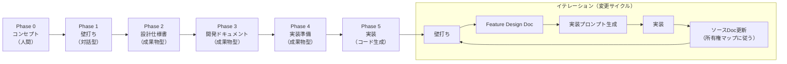
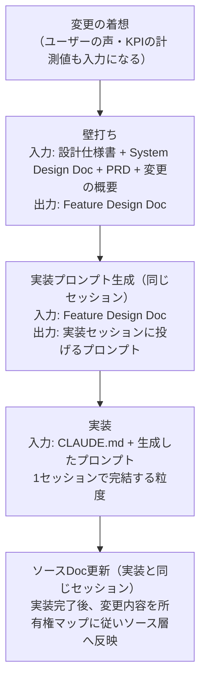
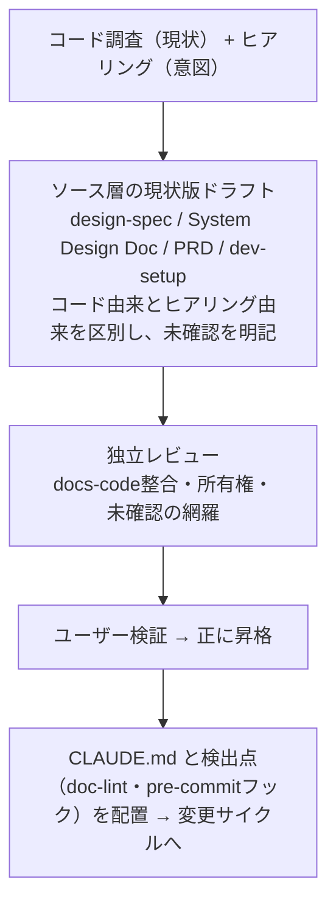
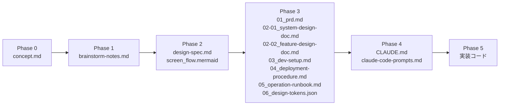
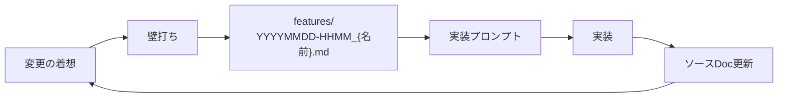

# DRAFT - Document-driven, Reproducible, AI-powered, Full-stack Toolkit

AI駆動のフルスタック開発フレームワーク。対話で設計を練り上げ、コーディングエージェントで実装する。再現可能な手順で、誰でも同じ品質のアウトプットを出せる。

現状の主対象は1人の開発者とAIの組み合わせで、チーム運用は未検証。

DRAFT という名前には2つの意味がある。

- 設計の下書き（Draft）: いきなりコードを書かない。コンセプトから設計書を段階的に練り上げ、確かな設計図ができてから実装に入る
- レースのドラフティング（Drafting）: 前を走る車の空力を借りて加速する技術。AIという先行者の力を借りて、開発を加速する

---

## 全体像



Phase 5を終えた後の変更は、すべてイテレーション（変更サイクル）として回す。既存プロジェクト（DRAFT外製）は Phase 0 からではなく、導入（「既存プロジェクトへの導入」節）からこのループに入る。

---

## 原則

**ファイルに書き出す。** 後工程に渡すのは常にファイル。口頭の合意ではなくMarkdownに書き出す。

**テクニカルドキュメントとして書く。** 読んだ人が作業できることだけが目的であり、装飾・誇張・前置き・総括は情報を足さないので書かない。

和文に混じった英語の構文が、読みにくさの大半を作る。本文中で `—` を挿入句の区切りに使わず、読点・括弧・文の分割に置き換える。項目と説明を並べるリストは `ラベル: 説明` の形にする。無生物主語（「データは〜を示している」）や名詞止め（「〜の実施が重要である」）は、動詞で言い切る。

太字は段落の頭に置く短いラベルとUI要素にだけ使う。文や表のセルを太字で覆うと、強調された語が消える。

対句（「AではなくB」）は意味を運ぶときだけ残す。リズムのために置くと、対比の無い所に対比があるように読める。この判定は文脈依存なので機械に委ねない。`—` と太字の乱用は決定論的に判定できるため、検出点が捕まえる。

**レビューは新鮮なコンテキストで。** 制作した本人ではなく、経緯を知らないコンテキストでレビューする。サブエージェントや新しいセッションに成果物だけを渡す。

**独立レビューを黙って諦めない。** 起動できないときにセルフレビューへ勝手に落とさない。理由と選択肢をユーザーに示して選ばせ、実際に取った経路を完了報告に明記する。品質基準を下げる決定はユーザーのものであり、AIが単独で下すものではない。

**ドキュメントがソース、実装は成果物。** 実装は常にソース層のドキュメントから再現できる状態を保つ。ここでいう再現は、同じコードを再生成することではなく、同じ仕様・能力を持つプロダクトを再構築できること。技術スタックや内部実装は異なってよい。

**違反は宣言ではなく検出点で捕まえる。** 先送りマーカー・ゴミ・シークレット・ドキュメントと実体の乖離・文体の決まった崩れのように決定論的に判定できる違反は、コミット前検査と doc-lint が機械的に検出する。検出は機械が担い、扱いの判断は既存の原則とユーザーが担う。何を作るか、どこまで詳細化するかのような文脈依存の判断は機械化しない。

根拠は実運用の観察にある。フローや機械検証に組み込まれた規律は守られ、宣言だけの規律は形骸化する。

**先送りしない。** 完了とは残作業がゼロの状態。スタブ・仮実装・ハードコードの穴埋め・未確認の箇所・「後で直す」を残さない。

ユーザーのスコープを縮めるのはユーザーの決定だが、自分の変更が作った穴を塞ぐのはスコープの縮小ではなく完了条件であり、合意を求めずその場で閉じる。やむを得ず残すときは、閉じられない理由を先送りの時点で名指しする。

残す先はリポジトリ内のファイルだけ。ファイルに書かれていないものは残っておらず、消えている（チャットや完了報告で行き先に言及しても記録にはならない）。実装中に見つけた設計の不備は、実装側の回避策で辻褄を合わせず、設計ドキュメントに戻して直してから実装を続ける。

---

## ドキュメント体系（3層と所有権）

ドキュメントがソースであり、実装はそこから生成される成果物。これがDRAFTの根本思想で、成立させるためにドキュメントを3層に分けて管理する。

### 3層構造

| 層 | ファイル | 役割 |
|----|---------|------|
| ソース | `design-spec.md`, `screen_flow.mermaid`, `01_prd.md`, `02-01_system-design-doc.md`, `03_dev-setup.md`, `04_deployment-procedure.md`, `05_operation-runbook.md`, `06_design-tokens.json` | 実装を再現するための正。常に「現在の状態」を反映する |
| 派生 | `CLAUDE.md`（と `AGENTS.md` リンク）, `claude-code-prompts.md`, `docs/README.md` | ソースから再生成可能。今のAIの制約（コンテキスト分割等）への足場 |
| アーカイブ | `concept.md`, `brainstorm-notes.md`, `features/`（FDD） | 経緯の記録。再現には使わない。書き換えず蓄積する（FDDは対象サイクルの実装完了時に確定してこの層に入る） |

実装を変えたらソース層を必ず現在の状態に更新する。更新履歴は残さない（経緯はFDDとgitが担う）。

派生層は古くなったらソースから作り直せばよい。ソースと食い違ったらソースが正。作り直すときは、旧版だけが持つ状態（進捗の記録・分割で追記したステップ・ブロッカー注記）を新版へ移送してから捨てる。状態はソースに無いため、再生成では戻らない。

アーカイブ層は更新しない。確定時点のスナップショットであることが役割になる。FDDは対象サイクルの実装完了・コミットまでは生きた設計書として修正・追記してよく、完了時にアーカイブとして確定する。確定後は書き換えも削除もせず、方針転換は新しいFDDを追加して残す。確定したFDDを次サイクルの設計入力にはしない（次サイクルの入力は常にソース層）。

### 事実の所有権

同じ事実を複数のドキュメントに書かない（コードのDRY原則と同じ）。事実ごとに所有ドキュメントを1つ決め、他のドキュメントは転記せず参照する:

| 事実 | 所有ドキュメント |
|------|----------------|
| なぜ作るか・誰のため・主要機能（ユーザーストーリー）・KPI・スコープ外 | `01_prd.md` |
| 画面の存在・目的・レイアウト・認証要否・UXの振る舞い・コアフロー・ビジュアルデザインの方針（トーン、カラー方向性、モード対応、情報密度） | `design-spec.md` + `screen_flow.mermaid` |
| デザイントークンの具体値（色・タイポグラフィ・余白・角丸・影・モーションの値） | `06_design-tokens.json` |
| 技術選定（ADR）・アーキテクチャ・API設計・データモデル・ルーティング・エラーハンドリング・i18n実装 | `02-01_system-design-doc.md` |
| 環境構築・コマンド体系（makeターゲット名）・ブランチ戦略・リリースフロー | `03_dev-setup.md` |
| 実コマンドの定義 | `Makefile` |
| デプロイ手順・ロールバック | `04_deployment-procedure.md` |
| 監視・障害対応 | `05_operation-runbook.md` |
| 変更の経緯（なぜ変えたか） | `docs/features/`（FDD）。振る舞い（仕様）が変わらない変更の経緯はコミットメッセージ（git） |

- **更新の判定**: 変わった事実の所有ドキュメントを更新する。変更規模の大小は関係ない
- **データモデル**: 所有権はPhase 3で移る。Phase 2では `design-spec.md`（論理設計）で固め、Phase 3で `02-01_system-design-doc.md`（ER図+ORMスキーマ）へ章ごと移す。移管時にdesign-specのデータモデル章は削除し、System Design Docへの参照1行に置き換える。以降のスキーマ変更はSystem Design Docのみを更新する（古い章を残すと、後続セッションがそれを正として読む）
- **画面一覧**: System Design Doc側はルーティング表に留める。ルートと画面の対応だけを持ち、画面の目的・レイアウト・認証要否は design-spec を参照する
- **ビジュアルデザイン**: 方針と値で分担する。方針（トーン・モード対応など）はPhase 2で `design-spec.md` に決め、具体値はPhase 3で `06_design-tokens.json`（DTCG形式）に確定する。以降、値の変更はトークンJSONのみを更新し、実装側のCSS変数・テーマ設定はそこからの派生として再生成する。design-specに具体値を書くと二重管理になり食い違う
- **ツールの自動メモリ**: MEMORYファイル等、セッション外に蓄積されるメモも転記禁止の対象。docs が所有する事実を写さない。食い違ったらソース層が正

### 方法論自身への適用

この3層はDRAFTリポジトリ自身にも適用される:

| 層 | 対象 |
|----|------|
| ソース | このREADME（方法論のspec）と `templates/`（テンプレート原本） |
| 派生 | `draft-plugin/` のスキル群とテンプレートコピー。READMEの実装にあたる。方法論のspecで食い違ったらREADMEが正（対話手順やツール使用といった実行の詳細はスキルが固有に所有する）。Claude Codeプラグインと、Agent Skills対応クライアント（Codex・Cursor等）向けの生成派生として配布される（配布形態は `draft-plugin/README.md` が所有） |
| アーカイブ | 変更の経緯（git履歴）と `manual-flow.md`（初期実装時点の手動フローのスナップショット。更新しない） |

方法論の本文（この節の外）は実装のスキル名を参照しない。工程とスキルの対応は `draft-plugin/README.md` のスキル表が所有する。事実の所有権をこのREADME自身にも適用したもので、specが実装名を知らなければ、スキルの改名や分割は本文に波及しない。

ルール（決まり事）にも層がある。意図・検証に関わるルールは**恒久**、今のAIの制約（コンテキスト分割等）を補うルールは**足場**であり、足場は理由が失効したら削除する。方法論は足すだけでなく、削って新陳代謝させる（このリポジトリでは evolve スキルのルールGCが担う）。

---

## Phase 0: コンセプト（人間が用意する）

### ゴール

「何を作りたいか」を1ページで言語化する。完璧でなくていい。

### 使用テンプレート

`templates/p-0/concept.md`

### やること

- アイデアをメモ書きレベルで書く
- 以下が含まれていると後工程がスムーズ:
  - 誰のためのプロダクトか
  - どんな体験を提供するか
  - 自分がなぜ作りたいか（ポートフォリオ？事業？学習？）

### 成果物

`concept.md`

### Tips

- 構成が雑でも問題ない。Phase 1でAIが構造化してくれる
- 「コンセプトに自信がない」状態でもPhase 1に進んでいい。壁打ちで磨かれる

---

## Phase 1: 壁打ち

### ゴール

コンセプトを「画面とフローが見える」レベルまで具体化する。`concept.md` を入力に、1つの対話セッションで進める。

### 壁打ちで決めること

| 項目 | 質問例 |
|------|--------|
| スコープ | MVP？フル機能？ポートフォリオ？ |
| ユーザーの種類 | ロールは何種類？権限の違いは？ |
| コアフロー | ユーザーが最も頻繁に行う操作は何？ |
| 画面一覧 | 何画面必要？各画面の目的は？ |
| 画面遷移 | 画面間の導線は？ |
| データ構造 | 主要なエンティティは？関係性は？ |

### 成果物

`brainstorm-notes.md` に、以下の合意事項をMarkdownで書き出す。セッション内の合意のままにせず、必ずファイルにして `docs/` に置く（原則「後工程に渡すのは常にファイル」）。

- 画面一覧（名称 + 目的 + 簡易説明）
- 画面遷移の全体像
- ロール定義
- コアフロー（最も重要なユーザー体験の流れ）

### Tips

- **選択式で聞く。** 直感で選んで先に進める。決定は後で変えられる。完璧を求めると止まる
- **推奨には理由を添える。** 「AとBならA（理由）」の形で根拠を示す。根拠のない推奨は、ユーザーが直感で選ぶための材料にならない。これは壁打ちの選択肢に限らず、技術選定や規模判定など推奨を出す全場面に共通する
- **1セッションに収める。** 壁打ちの文脈が途切れると議論が巻き戻る

---

## Phase 2: 設計仕様書

### ゴール

Phase 1の合意を「設計仕様書」として書き出す。開発者（自分を含む）が読んで画面を作れるレベルまで具体化し、`brainstorm-notes.md` を入力にする。

### 使用テンプレート

`templates/p-2/design-spec.md`

### 設計仕様書に含めること

1. プロダクト概要（コンセプト、方針（対応言語含む）、UI設計原則）
2. ユーザーロールとフロー
3. 画面一覧（全画面の名称・目的・レイアウト・認証要否）
4. コア画面の詳細仕様（各ステップで何が表示され、何が操作できるか。エラー・空・ローディング状態も含む）
5. ビジュアルデザイン方針（トーン&ムード、カラーの方向性、タイポグラフィの方向性、ライト/ダークモード対応、情報密度）。ここで決めるのは方向性までで、具体値はPhase 3のデザイントークンで確定する
6. データモデル（ER図 + 各テーブルのカラム定義）
7. 画面遷移図（Mermaid形式で別ファイル）

コアフローに関わる画面や仕様が曖昧な画面は、書きっぱなしにせず深掘りして詰める（開いたとき何が見えるか・操作できるアクション・各アクション後の状態遷移・エラー/空のときの表示・レイアウトパターン）。

### 成果物

| ファイル | 内容 |
|----------|------|
| `design-spec.md` | プロダクト設計の全体像 |
| `screen_flow.mermaid` | 画面遷移図 |

### Tips

- **仕様書は「長くていい」。** Phase 3以降でAIが参照するための情報源
- **データモデルはこの段階で固める。** 後から変えるとAPI設計から全部やり直し。所有権はPhase 3でSystem Design Doc（ER図+ORMスキーマ）へ移り、以降のスキーマ変更はSystem Design Docのみを更新する（移管時にdesign-spec側の章は削除され、System Design Docへの参照に置き換わる）
- **エラー・空・ローディング状態も仕様化する。** 正常系だけの仕様書だと、実装時に状態設計が抜ける
- **i18nの要否はこの段階で決める。** プロダクト方針に対応言語を明記する（不要なら「日本語のみ」）。後付けは高くつく
- **ビジュアルデザインは方針まで。** HEXコード等の具体値はここでは決めない（Phase 3の `06_design-tokens.json` が所有する）。ライト/ダークモードの要否だけはここで決める。後付けは高くつく
- **Mermaid図は別ファイルにする。** 仕様書本文に埋め込むとAIが図を読み飛ばすことがある

---

## Phase 3: 開発ドキュメント

### ゴール

設計仕様書を「開発着手できる」レベルの技術ドキュメントに変換する。

### 使用テンプレート

PROJECT-PLAYBOOK のドキュメントテンプレート一式:

| テンプレート | 内容 |
|-------------|------|
| `01_prd.md` | 概要/背景と目的、ターゲットユーザーと課題、主要機能（ユーザーストーリー）、成功指標（KPI）、スコープ外 |
| `02-01_system-design-doc.md` | Goal/Non-Goal、アーキテクチャ概要、技術選定(ADR)、ルーティング、API設計、データモデル、セキュリティ・パフォーマンス、エラーハンドリング、i18n、テスト戦略、モニタリング・ログ |
| `02-02_feature-design-doc.md` | 背景と目的、Goal/Non-Goal、影響範囲、実装アプローチ、詳細設計、テスト方針、ロールアウト計画 |
| `03_dev-setup.md` | 環境構築手順、必要なツール・アカウント、ローカル開発サーバー起動、テスト実行、ブランチ戦略・リリースフロー、トラブルシューティング |
| `04_deployment-procedure.md` | 各環境へのデプロイ手順、リリース前チェックリスト、ロールバック手順、デプロイ後確認、緊急時連絡先 |
| `05_operation-runbook.md` | モニタリング・ログ設計、監視ポイントとアラート、よくある障害と対処法、ログ確認方法、定期メンテナンス |
| `06_design-tokens.json` | デザイントークン（色・タイポグラフィ・余白・角丸・影・モーションの具体値。DTCG形式、プリミティブ+セマンティックの2層） |

### 進め方

設計仕様書とPROJECT-PLAYBOOKテンプレートを入力に、7ドキュメントを埋める。技術スタックが未定なら、用途と方向性（例: フロントはReact系、バックはTypeScript）を前提に選択肢を比較して先に確定させる。Feature Design Doc（02-02）はテンプレートのまま `docs/` に残し、イテレーションで雛形として使う。

プロジェクトの目的・規模に照らして該当しない成果物や節は、後続工程に必要な情報を失わない範囲で省略・統合してよい（判断材料はconcept.mdの目的。例えばデプロイしない自分用ツールに04・05のフル記述は不要）。省略したら `docs/README.md` に何を省いたかと判断根拠を1行残す。

ただしセキュリティの権限マトリクスとi18nの要否は省略しない。前者は実装後の独立レビューの照合先になり、後者は後付けが高くつく設計判断にあたる。不要なら「不要」とその根拠を明記する。

### 成果物

PROJECT-PLAYBOOKテンプレートに従った7ファイル + `docs/README.md`（ドキュメントインデックス）+ `.github/PULL_REQUEST_TEMPLATE.md`（PRテンプレート）。

### Tips

- **技術選定はこのフェーズで確定させる。** Phase 4以降で変えると手戻りが大きい
- **コマンドは標準makeターゲットに統一する。** 実コマンド（pnpm等）はMakefileに集約し、docsとCLAUDE.mdは `make dev` / `make test` 等のターゲット名だけを参照する。どのプロジェクトでも同じ操作体系になり、コマンド変更時の修正はMakefile1箇所で済む（Windowsはmake非標準のためWSL前提）
- **ADR（Architectural Decision Records）は必ず書く。** 「なぜこの技術を選んだか」がポートフォリオの差別化になる
- **セキュリティ章を必ず埋める。** 特に認可の権限マトリクス（ロール×リソース）。実装レビューで認可漏れを検出するには、照合先となる正がSystem Design Docに必要
- **API設計はリクエスト/レスポンスのボディまで書く。** バックエンド実装時のプロンプトで「API設計に従って」と指示できる
- **DBスキーマは実際のコード（Prisma/Drizzle等）で書く。** そのままコピペで使える状態にする
- **デザイントークンはDTCG形式（designtokens.org）に準拠する。** `$schema` 付きのJSONで、プリミティブ（生の値のスケール）とセマンティック（用途名。プリミティブへのエイリアス）の2層に分ける。実装が参照してよいのはセマンティック層のみ。CSS変数・テーマ設定は実装フェーズでこのJSONから派生として生成する。変換ツール（Style Dictionary等）の導入は必須ではない。使うなら技術選定としてADRに記録する

---

## Phase 4: 実装準備

### ゴール

実装フェーズに渡す2つのファイルを作る。コンテキストファイル（CLAUDE.md）と、ステップ別プロンプト集（claude-code-prompts.md）である。あわせて執行の検出点（`scripts/doc-lint.sh` と pre-commit フック）を配置する。

このフェーズの核心は、前提知識（毎セッション読まれるCLAUDE.md）と作業指示（都度渡すprompts.md）を分離することにある。

### 使用テンプレート

| テンプレート | 用途 |
|-------------|------|
| `templates/p-4/CLAUDE.template.md` | AIエージェントが自動読み込みするプロジェクトコンテキスト |
| `templates/p-4/claude-code-prompts.md` | ステップ別プロンプト集の構成ガイド |
| `templates/p-4/doc-lint.sh` | 決定論的整合の検出スクリプト（実行の検出点として配置） |

### CLAUDE.md に書くこと / 書かないこと

| 書く | 書かない |
|------|---------|
| 確定した技術スタック | ステップ別の作業指示 |
| ディレクトリ構成 | 変わりやすい情報（TODO、進捗） |
| 重要な設計方針（3〜5個） | 冗長な説明 |
| 開発コマンド一覧（標準makeターゲット） | 生コマンドの複製（真実源はMakefile） |
| docsへのファイルパス | |
| コーディング規約 | |
| 実装の規律（先送りの禁止・設計の不備を実装で回避しない・場当たり修正の禁止・コメントの規律など） | |
| エージェントの権限境界（本番資格情報を渡さない・破壊的操作の明示確認） | |

### ステッププロンプトの設計原則

| 原則 | 理由 |
|------|------|
| 1ステップ = 1チャット | コンテキスト劣化（自動要約による詳細の損失・注意の希釈）の防止 |
| ゴールを「動作確認可能な状態」で定義 | AIエージェントが完了判断できる |
| 参照すべきdocsファイルを明示 | 必要な情報だけ読ませる |
| 「まだやらないこと」を明示 | スコープクリープ防止（縛るのは未着手の機能。見つかった欠陥の放置理由にはならない） |
| 依存関係順に並べる | 前のステップの成果物が次の前提になる |

### 推奨ステップ構成（Webアプリの場合）

| Step | 内容 | 粒度の目安 |
|------|------|-----------|
| 1 | モノレポ骨格 + 開発環境 | フレームワーク初期化、Docker、.env、Makefile、doc-lintフックの配線 |
| 2 | DBスキーマ + シード | テーブル定義、デモデータ |
| 3 | バックエンドAPI（CRUD） | 全エンドポイント、バリデーション |
| 4 | 認証 | OAuth、ガード、protected routes |
| 5 | 共通UIコンポーネント | レイアウト、デザインシステム |
| 6 | コア画面 | 最も重要な画面 |
| 7 | 残り画面 | 2nd priority の画面群 |
| 8 | インフラ + CI/CD | Terraform、GitHub Actions、Dockerfile |
| 9 | テスト + 仕上げ | Unit、E2E、Lint、KPI計測の導入 |

### 成果物

| ファイル | 配置場所 | 用途 |
|----------|----------|------|
| `CLAUDE.md` | リポジトリルート | AIエージェントが自動読み込みする前提知識（実体はこの1つ） |
| `claude-code-prompts.md` | `docs/` | ステップ別プロンプト（派生層。docsと食い違ったらdocsが正） |
| `scripts/doc-lint.sh` + `.githooks/pre-commit` | リポジトリ | 決定論的整合の検出点（コミット前検査とdoc-reality検査） |
| `AGENTS.md` | リポジトリルート | `CLAUDE.md` へのシンボリックリンク（Codex等、AGENTS.mdを読むエージェントへの可搬性。実体は増やさない） |

CLAUDE.md の末尾には生成時のDRAFT版数を記録する。方法論は生成後も進化するため、guide がこのスタンプと現行版の差から、再生成や検出点の追加（バックフィル）を提案できるようにする。

### Tips

- **Step 1〜2は1セッションにまとめてもOK。** 骨格 + スキーマは依存が近い
- **UI実装ステップが最も重い。** コア画面と残り画面は分ける
- **インフラは後回しで良い。** ローカルで動くものを先に作る

---

## Phase 5: 実装

### ゴール

プロンプト集を順に実行し、動くアプリケーションを完成させる。

### 進め方

リポジトリを初期化し、CLAUDE.mdをルートに、Phase 2〜4の成果物（claude-code-prompts.md を含む）を `docs/` に配置する。

`docs/claude-code-prompts.md` のステップは、1つずつ新しいセッションで実行し、動作確認をパスしてから次へ進む。同一セッションでの実行をプロンプト集が明記しているステップ群だけが例外になる。

### ステップ間の動作確認

各ステップの最後に必ず動作確認する:

| Step | 確認方法 |
|------|----------|
| 骨格 | `make dev` で両方のサーバーが起動し、`make doc-lint` が通る |
| DB | `make db-push` + `make db-seed` + `make db-studio` でデータが見える |
| API | `curl` で各エンドポイントが200を返す |
| 認証 | ブラウザでOAuthログインが通る |
| UI | ブラウザでコアフローが一通り動く |
| インフラ | `terraform plan` がエラーなく通る |
| テスト | `make test` が全パス |

正常系だけで「動作確認済み」としない。異常系の最低ライン: 不正入力が設計どおりのエラー形式で返る・未認証アクセスが拒否される・空状態の表示が仕様どおり（Phase 2で仕様化した異常系を最低1経路ずつ確認する）。

Step 9で導入するコアフローのE2Eは、原則「実装はソース層から再現できる」の受入スイートを兼ねる。「同じことができる」の操作的な判定基準であり、実装を作り直してもこのスイートが通るなら意味レベルの再現は保たれている。

### 無人ループ実行

ステップの消化には2つの進め方がある。人が1ステップずつ新しいセッションを開くか、無人ループに回させるか。

Phase 5の状態は会話ではなくファイルにある。次のセッションは前のセッションを知らなくても、そこから続きを再開する。引き継ぎの説明は要らない。ループはこの性質の上に成り立つ。1反復は1ステップ、1セッション。この規律はループでも変わらない。人が守る規律から、ループが守る規律に変わる。

**停止条件。** 進捗の記録を3つの状態に分ける:

| 状態 | 意味 | ループの動き |
|------|------|------------|
| 未着手 | まだ手をつけていない | 次の対象として選ぶ |
| 完了 | 動作確認まで通っている | 飛ばす |
| 保留 | 着手したが、人の判断なしには閉じられない | ループを止める |

保留には、閉じられない理由を併記する。先送りの原則がもともと要求している「ブロッカーの名指し」を、機械が読める位置に移した。記録が「未着手か完了か」の2値だと、未着手と、着手して閉じられなかったステップが区別できない。ループは同じステップを永久に再試行する。ループはもう1つの条件でも止まる。1つのステップが2回続けて進捗を書かずに終わったときで、クラッシュとコンテキスト切れをこの形で捕まえる。

保留が付くのは、担当したステップだけではない。閉じられない部分を新しいステップとして切り出したときは、切り出し先にも保留と理由を付ける。状態を読むのは機械であり、ステップの本文に「ユーザーの決定が要る」と書いても届かない。未着手として書き出してよいのは、実装できる残り、つまり後の反復が回収できるものだけである。この区別が無いと、ステップ自身が人の判断を求めているのに、次の反復がそれを未着手として掴む。

**止まらない条件。** 止めるのは、人にできることがあるときだけである。実行環境の一時的な制約（利用上限のように、時間を置けば同じ条件で再開できるもの）は停止条件ではない。ここで人を呼んでも、人にできるのは待つことだけで、呼ばれるまでの時間がそのまま空転になる。待ってから同じステップを再開し、進捗を書かずに終わった反復としては数えない。累計の待機が上限を超えたときに、はじめて人を呼ぶ。

**始める前の確認。** 各反復で必ず使う能力は、ループを始める前に揃っていることを確かめる。独立レビューのように毎ステップで要るものが欠けたまま走ると、1ステップを作り切ってから保留になり、その作業が宙に浮く。能力の不足は走行中に見つけるのではなく、着手前に潰す。

**人の判断の扱い。** 無人ループには問い合わせる相手がいない。合意を省くのではなく、事前の承認を事後の監査に移す。移してよいのは、選択肢が複数あってどれを選んでも前に進む判断だけ。「品質基準を下げる」以外に道がない場面では、ループを止める:

| 場面 | 対話実行 | 無人ループ |
|------|---------|-----------|
| どのステップを実行するか | ユーザーに確認する | 進捗の記録から自動で選ぶ（判断ではなく機械的な選択） |
| ステップが大きすぎる | 縮める範囲の合意を取る | 自律的に分割し、残りを新しいステップとして書き出す |
| 設計ドキュメントの不備 | 直し方の合意を取ってからソース層を直す | 自律的にソース層を直し、判断を記録する |
| 人手を要する動作確認 | ユーザーに手動確認を依頼する | 自動で確認できる手段を用意して確認する。用意できなければ保留 |
| 独立レビューが起動できない | 選択肢を示して選ばせる | 保留 |

分割はループでは成果物を縮めない。残りは新しいステップとしてファイルに載り、後の反復で回収される。対話実行で合意を求めていたのは、口頭の「残りは次回」で消えるのを止めるためだった。回収が保証されるなら、この歯止めは要らない。回収を保証できるのは実装できる残りに限る。切り出す先が人の判断を要するものなら、それは分割ではなく保留である。独立レビューの起動不可はこれと違い、自律判断の対象外にする。ここでの選択肢は「品質基準を下げて進む」しか無い。品質基準を下げる決定はユーザーのものであり、ループはそれを代行しない。

**判断の記録。** 自律的に下した判断は、コミットメッセージに残す。何を選んだか、なぜそれを選んだか、他にどの選択肢があってなぜ採らなかったか。専用のログファイルは作らない。構築中の経緯はgitが所有しており、そこに二重管理を持ち込まない。チャットの出力は走行後に残らないので、記録にならない。

ループが終わったら、その走行で積まれたコミットを人が読む。これを省くと、事前の承認を飛ばした分がそのまま抜ける。

### Tips

- **残作業を残して完了にしない。** ステップのゴールを満たしていない状態は、名前が何であれ未完了。TODO/FIXMEコメント、スタブや固定値を返す仮実装、握りつぶした例外、確認していない経路、完了報告の「今後の課題」節は、すべて先送りの言い換えである。禁止するのは形ではなく先送りそのものなので、判定は形の列挙ではなく記録先で行う。その場で閉じたか、閉じられない理由つきで `claude-code-prompts.md` に書かれたか。どちらでもない残作業は、名前が何であれ消えている
- **スコープを縮めるのはユーザーの決定。** 1ステップが大きすぎると感じたら分割してよい（完璧な粒度は事前にはわからない）。ただし縮めた分をその場でユーザーに提示して合意を取り、残りを `claude-code-prompts.md` に新しいステップとして書き出してから完了とする。口頭の「残りは次回」で終わらせない
- **合意を求めること自体を完了の代わりにしない。** 「これも入れますか」と聞けば未完が未完でなくなるわけではない。合意が要るのはユーザーのスコープを縮めるときだけで、自分の変更が作った穴・自分で見つけた欠陥を塞ぐのに合意は要らない。それは縮小ではなく完了条件なので、聞かずに閉じる。許可を求める形は配慮に見えるぶん、先送りの隠れ蓑になりやすい
- **欠陥に「スコープ外」は無い。** 「まだやらないこと」が縛るのは未着手の機能であって、作った実装に見つかった欠陥ではない。自分やレビュアーが見つけた指摘は「欠陥か（仕様・意図からの乖離、壊れているもの）、改善提案か（仕様の外）」で判定する。欠陥の行き先は二つしかない。その場で閉じるか、閉じられない理由を名指しして合意のうえ `claude-code-prompts.md` に書き出すかである。「スコープ外」という第三の行き先を発明して落とさない。改善提案は残作業ではないので、記録せず完了報告で言及するに留める。構築中の残作業の行き先は `claude-code-prompts.md` ただ一つで、変更サイクル（イテレーション）は全ステップ完了後に始まる
- **残すときは、閉じられない理由を名指しする。** 「後で」ではなく「何がブロックしているか」（ユーザーの決定が要る／認証情報や外部リソースが無い／別ステップの成果物に依存する）を、先送りするその時点で事実として述べる。指摘を受けてから理由を組み立てると、指摘に整合するよう基準が後付けで作られ、検証できないものが基準の顔をする
- **エラーは場当たり的に直さない。** 根本原因を特定し、原因と修正方針を説明してから修正する。症状だけ抑えるパッチは、原因の解決を後ろに送っているだけであり、重ねると後のステップで修正困難になる
- **設計の不備は設計に戻して直す。** 「設計ドキュメントの記述では要件が満たせない・記述同士が矛盾している・必要な決定が欠けている」と気づいたら、実装側の回避策で辻褄を合わせて進まない。いったん止めて、不備の内容・影響・直し方をユーザーに提示し、合意の上でソース層を直してから実装を再開する。実装で先に解いて後からdocsを合わせると、設計判断がコードに埋もれてレビューもされずに確定する
- **合意済みの詳細調整は、実装後にソース層へ反映する。** 設計の不備ではない範囲の変更（API形状・スキーマ・UXの細部）は、事実の所有権マップに従い所有ドキュメントへ反映してからステップ完了とする。Phase 5完了直後の最初の壁打ちが古いドキュメントを入力にしないための規律
- **コメントはコードから読み取れないことだけを書く。** AIは行ごとの実況コメント（`// ユーザーを取得する` の直後に `getUser()`）を書きがちだが、情報を持たないうえコード変更に追随せず嘘になる。書くのは「なぜこの実装なのか」「不変条件」「外部制約」「呼び出し側の契約」。密度と体裁は周囲の既存コードに合わせる（プレフィックス等のプロジェクト固有の規約はCLAUDE.mdのCode Styleで決める）
- **生成されたコードは必ず独立レビューにかける。** 経緯を知らない新しいコンテキスト（サブエージェント/新セッション）にdiffだけを渡す。特にセキュリティ（認証ガード、バリデーション、追加された依存パッケージの実在と出所）、先送りと残骸（TODO/FIXMEコメント、固定値やモックを返す仮実装、握りつぶした例外、コードの言い換えでしかない余剰コメント、実ファイル追加済みディレクトリの `.gitkeep`）、docs整合（実装が設計ドキュメントから無断で逸脱していないか）
- **独立レビューを起動できないときの扱いは冒頭の原則に従う。** セルフレビューへ勝手に落とさず、理由と選択肢（サブエージェント使用の許可／新セッションでのレビュー／独立性を落として進む）をユーザーに示して選ばせ、取った経路を完了報告に1行で明記する。黙ってセルフに落とすと、レビュー済みという誤った前提のまま次のステップに進む

---

## イテレーション: 変更サイクル

Phase 5完了後の変更は、種別を問わずこのサイクルの1イテレーションとして扱う。機能追加もバグ修正もリファクタリングも「現在状態に対する1回の変更」であり、種別はコミットメッセージ（feat/fix/refactor/chore）が区別する。

Phase 0〜5のフル構築に比べて軽量で、1変更あたり壁打ちから実装まで短時間で完結する。

FDDの要否は変更の種別ではなく、「プロダクトの振る舞い（仕様）が変わるか」で決める。

- **変わる**（機能追加・仕様変更・UXの変更）→ FDDを作り、以下のフローで回す
- **変わらない**（リファクタリング・依存更新・chore、仕様に実装を合わせるだけのバグ修正）→ FDDは作らない。直接実装し、既存の動作が壊れていないこと（`make test` があれば全パス）を確認してコミットする。ソースDocの更新要否は所有権マップで判定する（例: コマンド体系が変わればdev-setupを更新）
- バグの原因が仕様側にあった（仕様どおりに動くが仕様が誤り）と判明したら、それは振る舞いの変更なのでFDDを作る

### フロー



設計（壁打ちからFeature Design Docまで）と実装はセッションを分けてよい。受け渡すのはFDDファイルであり、実装セッションはFDDから実装プロンプトを組み立て直せるため、生成済みプロンプトが手元に残っていなくても再開できる。

### 壁打ちの始め方

新しいセッションで、設計仕様書・System Design Doc・PRDと変更の概要（2〜3行で十分）を入力に壁打ちする。`docs/02-02_feature-design-doc.md` のテンプレートに従い、Feature Design Docを作ることをゴールにする。

壁打ちで必ず検討すること:

- この機能はPRDのKPI・スコープに照らして作る価値があるか
- 既存の画面・APIへの影響範囲
- DBスキーマの変更が必要か
- 新規画面・エンドポイントが必要か

#### 変更の大きさで分岐する

| 変更規模 | 判断基準 | 進め方 |
|---------|---------|--------|
| 小 | 既存画面内の修正、APIパラメータ追加程度 | 壁打ちなしでFeature Design Docを直接書いてもOK |
| 中 | 新規画面1〜2枚追加、スキーマ変更あり | 壁打ちでFeature Design Docを作成 → 1セッションで実装 |
| 大 | 新ロール追加、コアフロー変更 | 壁打ちでFeature Design Doc作成 → 複数セッションで実装 → ソースDoc更新 |

規模はプロセス（壁打ちの要否・セッション分割）の判断にのみ使う。どのドキュメントを更新するかは規模ではなく所有権マップで決まる（例: 新規画面が入る中規模でも design-spec.md は更新する）。

### Feature Design Docの成果物化

壁打ちが終わったら、同じセッションで成果物化する。`docs/02-02_feature-design-doc.md` のテンプレート構成に従い、`docs/features/YYYYMMDD-HHMM_{機能名}.md` に配置する。タイムスタンプは実際の現在時刻を使う（丸めない、推測しない）。

### 実装プロンプトの生成

Feature Design Docができたら、同じセッションで続けて実装プロンプトを生成する。Phase 4でclaude-code-prompts.mdを作ったのと同じ考え方で、「何を作るか」（Feature Design Doc）と「どう指示するか」（プロンプト）を分離する。

実装プロンプトの原則:

- 実装の依存関係順に並べる（スキーマ変更 → API → UI）
- 各ステップに明確なゴール（「〜が動く状態」）を定義する
- 参照すべきdocsファイル（最低限、対象FDD）を明示する
- 完了条件に既存テストの回帰確認（`make test` 全パス）を含める（新しい変更の動作確認だけでは、diffの外にある既存機能の破壊を検出できない）
- 変更規模が大きい場合はセッションを分割する粒度で書く
- 末尾にソースDoc更新の指示を含める（次節）

### ソースドキュメントの更新

実装完了・動作確認後に、ソース層のドキュメントを現在の実装に合わせて更新する。ソース層は「現在の状態」を表すドキュメントなので、更新は実装前ではなく実装後に行う。実装中に方針が変わることがあり、確定した状態を反映するのが正しいタイミングになる。

更新対象は事実の所有権マップに従う。更新は「現在の状態」の書き換えとして行い、更新履歴・編集ログ・FDDへの参照注記は残さない。

この更新指示は実装プロンプトの末尾に組み込んでおく。別作業にすると忘れるが、プロンプトに含めれば実装と同じセッション内で実行される。

ただし「実装後に更新する」のは合意済みの範囲の話である。実装中にFDDやSystem Design Docの不備（その設計では要件が満たせない・記述同士が矛盾する・必要な決定が欠けている）に気づいたら、実装側の回避策で辻褄を合わせて進まない。止めて不備の内容と直し方をユーザーに提示し、合意の上でFDDを直してから実装を再開する。実装を先に通してドキュメントを後から合わせると、設計判断がコードに埋もれ、レビューされないまま確定する。

コミット前に、経緯を知らない新しいコンテキスト（サブエージェント／新セッション）にdiff・FDD・更新後ドキュメントだけを渡し、実装とドキュメントをレビューさせる。起動できないときはセルフレビューへ勝手に落とさず、冒頭の原則に従って選択肢をユーザーに示す。

実装後に更新する理由:

- ソース層のドキュメントは次のイテレーションの壁打ちで入力として使う
- 常に「現在の状態」を反映していないと、AIが古い情報で設計してしまう
- Feature Design Docは「変更の経緯」（なぜ変えたか）、ソース層は「現在の状態」（今どうなっているか）という役割分担
- この役割分担のため、更新履歴・編集ログ・FDDへの参照注記を正本ドキュメントに残さない（経緯はFDDとgit履歴が担う）。例外はADRで、設計判断が変わった場合は「現在の設計のなぜ」としてADRを追加・更新する

### Branch/Commitの作成

ブランチ運用は `docs/03_dev-setup.md` のブランチ戦略に従う。未定義ならこの時点で決めてdev-setup.mdに追記する。小規模な変更や構築初期はmain直コミットでよく、スキーマ変更・新規画面など影響範囲が広い変更は実装前にブランチを切る。

リリース（本番反映）はブランチで表現せず、同ドキュメントのリリースフローに従う（環境ごとのバージョン宣言ファイルを更新するpromotion PR。ロールバックはrevert）。

コミットの前に、機械で判定できる違反を機械的に検出する。`scripts/doc-lint.sh --staged` があればそれを使い、無ければ同等の検査を行う（追加行の先送りマーカー・ゴミ・シークレット・実ファイルのあるディレクトリの `.gitkeep`・文体）。検出の扱いは先送りの原則に従う。自分の変更が作ったものはその場で閉じ、意図的に残すものはブロッカーを名指しした上でユーザーの判断で通す。

#### メッセージの流儀

コミットメッセージはリポジトリの流儀に合わせる。既存のコミットを参考にする場合は、onelineではなく全文を確認する。流儀として合わせるのは言語・時制・プレフィックス・ボディの書式（箇条書きの立て方など）までで、ボディの長さは流儀に含めず後述の形式基準に従う。

署名や帰属トレーラー（Co-Authored-By、セッションURLなど）も流儀に含めない。リポジトリの規約が明示的に要求している場合にだけ付ける。履歴にトレーラーが並んでいることも、実行環境やツール側の既定指示も、規約の根拠にはならない。環境が付けたトレーラーが履歴に溜まり、その履歴を根拠にまた付ける、という自己参照になる。

この方針は `CLAUDE.md` と `docs/03_dev-setup.md` に断定形で書く。実行環境の既定指示は全セッションに常駐するのに対し、スキル本文はスキルを呼んだときしか読まれない。規約として書かれて初めて、環境既定に優先する側に立てる（プレースホルダのまま空欄だと重みを持たない）。

#### メッセージの言語

言語は、書き始める前に独立した判定として決め、明示してから書く。優先順位は `docs/03_dev-setup.md` の宣言、既存コミットの言語、英語の順。

対話の言語は根拠にならない（日本語で壁打ちしていても、リポジトリの流儀が英語ならメッセージは英語）。言語を「流儀」の一項目として暗黙に扱うと、対話が続いている言語に引きずられて履歴と食い違うため、判定を明示する。

#### メッセージの形式と長さ

形式は言語と同じく、流儀の読み取りとは別の固定基準として扱う。

- サブジェクトは50字以内を目安とし、72字を超えない（超えると `git log --oneline` やGitHubのUIで切れる）
- 本文はサブジェクトとの間に空行を置き、表示幅72カラムで折り返す。日本語混在行は文字数ではなく表示幅で数える（全角は2カラム）
- 本文に書くのはdiffから復元できないことだけ。なぜ変えたか、何を検討して採らなかったか、どこまで検証したか
- 実装を含むサイクルのコミットでは、「どこまで検証したか」に独立レビューの実施経路を1行含める（例: 観点別3並列、セルフのみでユーザー承諾済み）。チャットの完了報告は揮発するため、次のセッションから検証できる記録はコミット本文に置く
- 変更ファイルの一覧やバージョン番号の更新のように、`git show --stat` とdiffが持っている事実は書かない

本文の長さはこの基準の結果として決まる。書くべきwhyがあれば長くてよく、無ければサブジェクトだけでよい。

長さの根拠に既存の履歴を使わない。直前のコミットしか基準が無いと、それに合わせるか超えるかしかできず単調に膨らむ（トレーラーと同じ自己参照）。

### Feature Design Docの管理

ファイル名に `YYYYMMDD-HHMM_` プレフィックスをつけ、時系列を明示する。

```
docs/
├── 設計仕様書.md
├── 01_prd.md
├── 02-01_system-design-doc.md
├── 02-02_feature-design-doc.md        ← テンプレート（空のまま残す）
├── features/                           ← 実際のFeature Design Docs（時系列順）
│   ├── 20260310-0918_notification.md
│   ├── 20260310-1446_email-digest.md
│   ├── 20260318-1103_social-ranking.md
│   └── 20260401-1427_ai-scoring.md
├── 03_dev-setup.md
├── 04_deployment-procedure.md
└── 05_operation-runbook.md
```

### Tips

- **壁打ちには必ず設計仕様書・System Design Doc・PRDを入力にする。** 既存の設計との整合性と、機能がKPI・スコープに照らして作る価値があるかを判断させるために必要
- **振る舞いが変わる変更は、小さくてもFDDを残す。** タイムスタンプ付きで蓄積すれば変更履歴になる。振る舞いが変わらない変更（リファクタ・依存更新・chore・仕様に実装を合わせるだけのバグ修正）はFDDを作らず、経緯はコミットメッセージが担う
- **Feature Design Docをそのまま実装セッションに渡さない。** 設計書と実装指示は役割が違う。実装プロンプトを生成するステップを挟む
- **スキーマ変更がある場合はマイグレーション計画を先に詰める。** 実装後に「マイグレーション通らない」となると手戻りが大きい
- **回帰は既存テストだけが検出する。** 独立レビューのレビュアーは渡された範囲の外を見ないため、diff外の既存機能を壊していないことは既存スイートの全パスでしか確認できない。イテレーションの完了条件に `make test` を含める（テスト資産が無いプロジェクトでは、その事実を完了報告に明記する）
- **ソースDocの更新は実装プロンプトに組み込む。** 別作業にすると忘れる。プロンプトに含めれば実装と同じセッション内で自動で実行される

---

## 既存プロジェクトへの導入

DRAFTの外で作られたプロジェクト（または docs が失われたプロジェクト）に変更サイクルを接続するには、壁打ちの入力になるソース層が要る。Phase 0〜5を踏み直すのではなく、実装コードから現状版を逆生成する。



導入の原則:

- **現状を写す。** 理想は書かない。dev-setupのブランチ戦略は実態を書く（宣言と実態の乖離を初日から作らない）
- **意図を捏造しない。** コードから読めない事実（KPI・スコープ外・選定理由）は、ヒアリングで得られなければ「未確認」と明記する
- **アーカイブ層は空から始める。** concept と brainstorm は作らない。以後の経緯はFDDとgit履歴が蓄積する

---

## フェーズ間の成果物フロー



Phase 5の後は、変更のたびにイテレーションを回す。



各Phaseの成果物は次のPhaseの入力になる。飛ばすと品質が落ちる。

---

## テンプレート一覧

| テンプレート | Phase | 説明 |
|-------------|-------|------|
| `templates/p-0/concept.md` | 0 | コンセプトメモ |
| `templates/p-2/design-spec.md` | 2 | 設計仕様書 |
| `templates/p-2/screen_flow.mermaid` | 2 | 画面遷移図 |
| `templates/p-3/project-playbook`(PROJECT-PLAYBOOK テンプレート一式) | 3 | 開発ドキュメント |
| `templates/p-4/CLAUDE.template.md` | 4 | AIエージェント用コンテキスト |
| `templates/p-4/claude-code-prompts.md` | 4 | ステップ別プロンプト集 |
| `templates/p-4/doc-lint.sh` | 4 | 決定論的整合の検出スクリプト（コミット前検査とdoc-reality検査） |
| PROJECT-PLAYBOOK `02-02` | イテレーション | Feature Design Doc |

---

## アンチパターン

| やりがちなこと | なぜダメか | 代わりにやること |
|--------------|-----------|---------------|
| コンセプトなしでいきなり「アプリ作って」 | 方向性がブレて手戻り大量 | Phase 0〜4を踏む |
| 設計仕様書なしで開発ドキュメントを作る | API設計とUI設計が噛み合わない | Phase 2で画面仕様を固めてからPhase 3 |
| 全ステップを1つのセッションで実行 | コンテキストの肥大で品質低下（自動要約による詳細の損失・注意の希釈） | ステップごとにセッションを分ける |
| CLAUDE.mdにステップ別指示を書く | 毎回読まれるので情報過多 | CLAUDE.md = 前提知識、prompts.md = 指示 |
| 技術スタックを実装フェーズで変更 | ドキュメント全体の書き直し | Phase 3で確定させる |
| 動作確認せずに次のステップへ進む | エラーが積み上がって修正困難 | 各ステップ後に必ず動作確認 |
| 変更の壁打ちで設計仕様書を読ませない | 既存設計と矛盾する設計が出てくる | 設計仕様書 + System Design Docを必ず入力にする |
| 実装後にソースDocを更新しない | 次の壁打ちで古い情報を元に設計してしまう | 実装プロンプトにドキュメント更新指示（所有権マップ準拠）を組み込む |
| Feature Design Docをそのまま実装セッションに投げる | 設計書には実装に必要な依存順・検証可能なゴール・スコープ境界が無い（役割が違う） | 実装プロンプトを生成してから渡す |
| 同じ事実を複数のドキュメントに書く | 更新漏れで食い違い、どれが正か不明になる | 所有ドキュメントを1つ決め、他は転記せず参照する |
| 既存プロジェクトでソース層なしのまま変更サイクルを回す | 壁打ちの入力が無く、既存設計と矛盾する変更が積み上がる | 導入（「既存プロジェクトへの導入」節）でソース層を逆生成してから変更サイクルへ |
